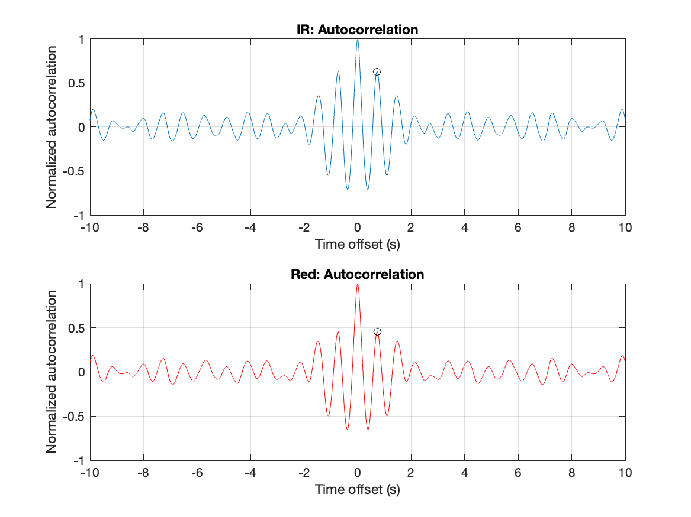
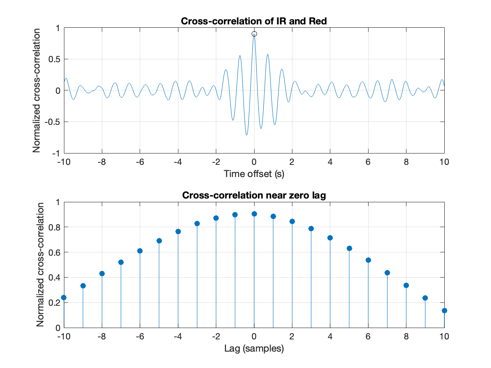

# E51 Lab 3: PPG signals from the Muse 2 headband

All of the code is in `dataScript.m`. It reads `ppg_lab3.csv` (3570 samples at 64 Hz, about 56 s; `PPG1` is ambient light, `PPG2` is infrared, `PPG3` is red) and saves `fig1` to `fig8`. Steps 1 to 9 are Analyses 1 to 4. This file explains Analyses 5 and 6 (Steps 10 and 11) and then gives the discussion and conclusion for the whole lab.

## Command Window output of `dataScript.m`

```
192 dropped samples out of 3570
Heart rate(IR): 85.0 bpm
Heart rate(Red): 85.0 bpm

       PeaksCount     PSD     Difference
IR:       82.0      85.0     3.0 bpm
Red:      82.0      85.0     3.0 bpm

Heart Rate Variability:
IR: RMS peak time: 0.060 s, SDNN: 0.072 s
Red: RMS peak time: 0.058 s, SDNN: 0.070 s

Autocorrelation first peak:
IR:  lag 0.719 s, value 0.63, heart rate 83.5 bpm
Red: lag 0.734 s, value 0.46, heart rate 81.7 bpm

Cross-correlation (IR vs Red):
Maximum 0.903 at lag 0 samples = 0.0000 s
Values at lags -1, 0, +1 samples: 0.899 0.903 0.885
```

## Analysis 5

*Autocorrelation (Step 10)*

We took the mean out of each cleaned signal and ran `xcorr(x - mean(x), 'coeff')`, the same way as the zero-mean autocorrelation example from Class 06. We took the mean out first because a leftover offset would put a big triangle on top of the plot and bury the peaks. `'coeff'` scales the result so it equals 1 at zero lag, which lets us compare the two channels even though the IR pulse is about four times bigger than the red one.

If a signal repeats, its autocorrelation has a peak every time the shift equals one period. So the first peak after zero lag is the time between heartbeats. We searched for it between 0.4 and 1.2 s, which covers 50 to 150 bpm.

The first peak is at 0.719 s for IR (83.5 bpm) and 0.734 s for red (81.7 bpm). That is 46 and 47 samples, so the two channels are only one sample apart, and one sample at this lag is worth about 1.8 bpm. The peak is 0.63 high for IR and 0.46 for red, and after about 2 s the peaks are all under 0.2. If the heartbeat were perfectly regular the peaks would stay tall, so the quick drop tells us the time between beats was changing.



## Analysis 6

*Cross-correlation of the red and IR channels (Step 11)*

Here we followed the MATLAB example the handout points to, "Align Signals Using Cross-Correlation": run `xcorr` on the two zero-mean signals, find the lag where it is largest, and divide that lag by the sample rate to get the time shift. We used `'coeff'` again so the peak reads as a correlation.

The largest value is 0.903 and it is at lag 0. So the red and IR channels are lined up, with no time shift we can see at one sample (1/64 s = 15.6 ms), and we did not need to shift either one.

One small thing: the values at lags -1, 0 and +1 are 0.899, 0.903 and 0.885, which is a little lopsided. That hints at a shift smaller than one sample, but at 64 Hz we cannot measure it.



## Discussion

The cleaning made the biggest difference. In the raw IR signal the pulse is well under 1% of the signal level and the baseline drifts by several times that, so we could not pick out any beats until after the 0.5 Hz high-pass filter. The 192 dropped samples come in short bursts of 6 samples, about 0.09 s, so filling them in with a straight line worked fine.

The two channels tell the same story: 85.0 bpm from the power spectral density, 82.0 bpm from counting peaks, and a correlation of 0.903 between them. IR is the better channel, with a pulse about four times bigger and a taller autocorrelation peak (0.63 against 0.46).

All of the heart rate estimates land between about 82 and 85 bpm. In `fig5_psd.png` the heartbeat is a cluster of lines from 1.2 to 1.5 Hz and not a single line, and 85.0 bpm is just the tallest one. Counting peaks gives an average, and dividing the count by the 30 s window can be off by as much as one beat (2 bpm), which explains part of the 3.0 bpm difference in Step 8. The autocorrelation results sit in between.

The heart rate was not steady. The intervals have a standard deviation of about 0.07 s, the spectrum is spread out, and the autocorrelation dies off fast, which fits what we saw in class for a healthy heart rate. The variability numbers should be read with some care, though: we only know each peak time to the nearest sample (15.6 ms), and Step 9 only uses the beats between 10 and 40 s.

## Conclusion

From about 56 s of forehead PPG we measured a heart rate of roughly 83 bpm, with every method and both channels landing between 82 and 85 bpm. The time between beats varied, with a standard deviation of about 0.07 s. The red and IR channels are lined up to within one sample, with a correlation of 0.903, and the IR channel gave the cleaner signal.
